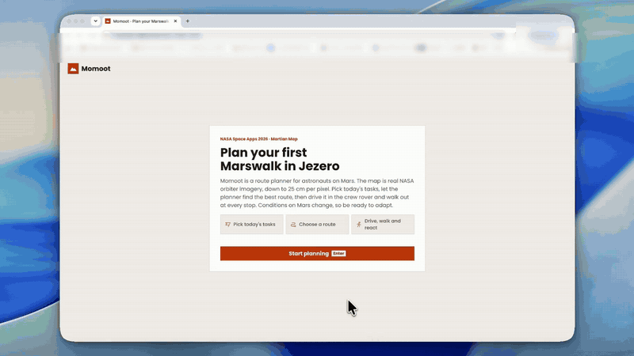

# Momoot · Komoot for Mars

A route planner game for astronauts on Mars, built by **Alice** for the
**2026 NASA Space Apps Challenge** · *Interplanetary Survival Guide: Martian Map*.

Pick today's science mission, compare three routes built from NASA orbiter data,
then walk it. Conditions on Mars change, so dust storms, solar particle events
and rough terrain force you to adapt on the way.

## 🎬 Demo video

[](https://ruoyaoyan.github.io/nasa_hacka_alice/docs/demo/momoot_demo.mp4)

A 30 second walkthrough of a full sol: pick today's tasks and a landing site, watch the
hazard scan sweep the HiRISE imagery, compare the Safest, Fastest and Easiest routes
with their route details, press **Change your mind?** to add tasks and redesign all
three routes, then start the EVA, react to a soft sand event on the way, and finish
with all tasks done. (The preview above plays at double speed.)

▶ **[Watch the full video](https://ruoyaoyan.github.io/nasa_hacka_alice/docs/demo/momoot_demo.mp4)** (30 s, no sound)

## ▶ Play now

**https://ruoyaoyan.github.io/nasa_hacka_alice/**

Served by GitHub Pages from the `momoot` branch: every push or merge to `momoot` goes live about a minute later.

**Recording a demo video?** Open **https://ruoyaoyan.github.io/nasa_hacka_alice/?demo=1** to start with a dust storm:
the storm event shows up early on every route, and sightseeing and rim climbs are closed (grey).
Turn it off with **[`?demo=0`](https://ruoyaoyan.github.io/nasa_hacka_alice/?demo=0)** or in **Settings → Developers only → Demo weather**.


## Play it

No install and no build step. Either:

- **Open `index.html`** in Chrome, Edge, Firefox or Safari, or
- **Serve the folder** (needed for some browsers to load local photos):
  ```bash
  python3 -m http.server 8000
  # then open http://localhost:8000
  ```

To publish it, turn on **GitHub Pages** for this repo (Settings → Pages →
Deploy from a branch → `momoot`, folder `/ (root)`) and share the link.

### Controls

| Key | Action |
|---|---|
| `Enter` | Start planning / start the EVA |
| `1` `2` `3` | Pick a route (planning) or a choice (events) |
| `Space` | Pause the walk |
| `F` | Fast forward |
| `S` | Collect a sample at a stop |
| `P` | Log a photo point for the next crew |
| `+` `−` | Zoom the map |
| `D` | Draw mode: click the map to log `[lat, lon]` points |

## How it works

1. **Pick today's tasks, then land at the best site**: a full page briefing with
   five everyday tasks, five Sightseeing viewpoints (photos left as view points for
   the next crew) and ten tasks farther away. A live panel beside them shows:
   - **Best fit for today**: the next tasks to add, re-ranked on every click by
     priority, how far each one adds to the tour, and which data type is still
     missing.
   - **Best landing site**: the five landing sites (A to E) ranked by the shortest tour
     through your tasks (exact visiting order, straight lines plus 30 % for
     detours). The habitat lands at the best one unless you pick another.
   - **EVA budget**: estimated distance, time outside and life support use
     against the 30 % reserve.
2. **Choose a route**: *Safest*, *Fastest* or *Easiest*. Each visits the same
   targets you ticked and shows Komoot style route details (below).
3. **Walk it**: the HUD tracks oxygen, suit power, radiation dose and distance.
   Science stops show what you would see on arrival.
4. **Leave data for the next crew**: press `P` (or the button) to log a photo point
   tagged hazard, tip, science or view. It saves in your browser, appears on the
   map and in *Crew photo points*, and hazard reports make future routes keep clear.
5. **React**: events pause the walk and ask for a decision. Returning early,
   sheltering, or pushing on all have costs.
6. **EVA report**: tasks done, the science return (core samples, image sets,
   measurements, panoramas), life support left, EVA time and radiation dose. No
   points: each task has a High, Medium or Low priority instead.

### Route details, as in Komoot

| Section | What it shows |
|---|---|
| Route details | Elevation profile on the Mars datum (Jezero floor about −2,560 m), steep stretches in orange, target markers. Click and drag to get uphill, downhill, highest and lowest point for that part; it is highlighted on the map |
| Climbs and descents | Each climb or descent with category, average grade, height gain and length. Click one to select it |
| Terrain types and surfaces | Kilometres of each of nine terrain types (crater floor, delta deposits, Margin unit, Neretva Vallis channel, Belva crater, rim slopes, Lac de Charmes valleys and ridges, megabreccia blocks, sand ripple fields), and of bedrock, gravel, loose sand, rough ground and boulders. *Layers → Terrain types* shows them on the map |
| Weather | Perseverance MEDA's latest sols: high and low temperature, pressure, sunrise and sunset, live from NASA's feed when the browser can reach it. Dust opacity for the season from the Montabone dust climatology |
| Crew intel on this route | Every crew note within 200 m of the selected route, in the order you will pass it, with how many later crews confirmed it |
| Crew photo points | The shared map of notes and HiRISE snapshots left by earlier crews and by you |


## NASA data

| Feature | Data | Type |
|---|---|---|
| Base map | HiRISE 25 cm and CTX 5 m imagery (Mars Reconnaissance Orbiter), Viking colour mosaic, live from [Mars Trek](https://trek.nasa.gov/mars/) | Optical |
| Elevation layer | MOLA colour shaded relief (Mars Global Surveyor) via Mars Trek | Topographic |
| Perseverance path | Mars 2020 traverse published by NASA JPL | Rover data |
| Minerals layer | CRISM mineral map of Jezero (MRO), [Parente et al. 2021, Zenodo](https://doi.org/10.5281/zenodo.5575824), CC BY 4.0. Built by `tools/crism/make_crism_overlay.py` | Spectral |
| Sand vs bedrock layer | THEMIS daytime infrared controlled mosaic, 100 m (Mars Odyssey), live from Mars Trek | Thermal |
| Stop photos | Perseverance raw images gallery | Ground imagery |
| Weather panel | Perseverance MEDA daily temperature and pressure, [NASA weather feed](https://mars.nasa.gov/mars2020/weather/), live with a bundled copy as fallback | Atmospheric |
| Dust season, dust event | Column dust opacity at Jezero by season, Mars Years 24 to 36, Montabone et al. 2015 and 2020, CC BY-SA 3.0 | Atmospheric |
| Radiation background | Curiosity RAD surface average, 0.64 mSv per sol (Hassler et al. 2014) | Radiation |
| Crew photo points | Notes, hazard reports and ratings logged by crews, passed on as a crew log file | Crowd sourced |

## The map: real NASA imagery

The map loads live tiles from **NASA Mars Trek** in your browser, in Mars Trek's
equirectangular projection, so routes and pins sit on true Jezero coordinates.
Higher resolution layers fade in as you zoom:

| Zoom | Layer | Resolution |
|---|---|---|
| Wide | Viking MDIM 2.1 colour mosaic | 232 m per pixel |
| Regional | MRO CTX global mosaic (Caltech Murray Lab) | about 5 m per pixel |
| Close up | MRO HiRISE orthomosaic of the Mars 2020 landing site (USGS) | 25 cm per pixel |
| Optional | MGS MOLA colour shaded elevation | 463 m per pixel |
| Overlay | Mars Odyssey THEMIS day IR (sand warm and bright, rock cool and dark) | 100 m per pixel |
| Overlay | MRO CRISM mineral map of Jezero, with the dataset's own colour key | 18 to 36 m per pixel (CRISM targeted images) |

Drag to pan, scroll or use **+ / −** to zoom, and use the layers button to
switch base maps or show Perseverance's real path (loaded from NASA JPL if its
server allows it). An internet connection is needed for the tiles. The **Open in Mars Trek** button opens the current view in NASA Mars Trek, where you can use its own distance, elevation profile and slope tools to check a route.

**Positions.** Stops that Perseverance visited sit exactly where the rover was,
taken from NASA's waypoint file (`data/m20_waypoints.js`, a copy of
`M20_waypoints.json`, 708 positions from sol 13 to 2022). For example: Séítah
(sol 248), Enchanted Lake (sols 415 to 428), Hawksbill Gap (sols 441 to 464),
Three Forks depot (sols 654 to 686), Echo Creek at Belva (sols 765 to 775), the
upper fan boulder field (sols 843 to 848), Neretva Vallis (sols 1150 to 1156),
Dox Castle (sols 1250 to 1288), the rim climb (sol 1295) and Lookout Hill (sol 1354).
Belva crater's centre follows the USGS gazetteer. Kodiak butte, the isolated hill and
the sightseeing skyline spot were never visited and are estimates; each line in
`data/missions.js` says which is which. The same file draws Perseverance's real path
on the map (Layers, then Perseverance's real path).

**Terrain check.** The elevation model is calibrated against the rover's measured
elevation at 522 waypoints: the average error (RMS) is 22 m, down from 143 m for the
first version. Lookout Hill comes out at −1,774 m against −1,786 m measured.

**Photos.** Every task shows a real Perseverance image of that place (or the
closest one the rover imaged), loaded from NASA's servers when the game runs.
The list, with PIA numbers and credits, is `photos` in `data/missions.js`. If an
image cannot load, the card shows a HiRISE view of the exact spot instead.

## Science layers and weather

**THEMIS day IR (Layers → Sand vs bedrock).** By day, loose sand and dust heat up
fast and show bright; bedrock stays cooler and shows dark. The tiles load live from
Mars Trek (`THEMIS_DayIR_ControlledMosaics_100m_v2_oct2018`). Zoom out a little:
each pixel is 100 m.

**CRISM minerals (Layers → Minerals).** Run once to build the overlay from the
public CRISM mineral map of Jezero (1.4 MB, needs only Pillow and numpy):

```bash
python3 tools/crism/make_crism_overlay.py
```

It downloads `jezeroFinal.tif` and its colour key `jezeroEM.png` from Zenodo, reads
the GeoTIFF georeference, makes null pixels transparent and writes
`data/crism_jezero.png`, `data/crism_jezero.json` (bounds, credits) and
`data/crism_legend.png`. Commit those three files. Until they exist the layer
switch is greyed out and says so.

**Weather.** The panel shows what Perseverance's MEDA station measured: high and
low temperature, pressure, sunrise and sunset. The game asks NASA's feed first and
falls back to the copy in `data/weather.js`; refresh that copy with
`python3 tools/weather/snapshot_meda.py`. Dust opacity comes from the Montabone
climatology for the Jezero cell at the same season (Ls), and the dust storm event
quotes the real number for that season: average τ 0.36, up to τ 0.70 in Mars Year 25.

## Crew photo points: a map every crew adds to

Komoot gets better because every hiker leaves highlights. Momoot does the same on Mars:

1. **Before you leave**, *Crew intel on this route* lists every note within 200 m
   of the route you picked, in driving order, with who left it and how many later
   crews confirmed it. Active hazard reports already push the routes away.
2. **On the way**, each note pops up as the rover reaches it. Press `Y` (still
   there / helpful) or `N` (gone now / not useful). A hazard that more crews report
   gone than confirm stops blocking routes; one that keeps being confirmed stays.
3. **Leave your own** with `P`: hazard, tip, science or view, with a HiRISE
   snapshot of the spot. Hazards re plan every route straight away.
4. **Hand it over.** *Send crew log* saves your notes and ratings as a JSON file;
   *Load a crew log* on another device merges them (no duplicates, ratings merged,
   every field checked). That file is the crew handover.

## The finish page

When you get home the EVA report replays your drive: the route draws itself on a
dusk sky, each finished stop pops in with a tick, the outcome stamp lands (Mission
complete, Safe return, Rescued), then tasks, life support, EVA time and dose count
up, followed by your science return and what you left for the next crew. With
*reduce motion* turned on, everything appears at once.

## How routes are planned

Routes are not drawn by hand. Real traverses wind because the crew has several
things to do (collect samples, take photos, take measurements) and has to avoid
danger on the way. `planner.js` solves exactly that:

1. **Terrain cost map.** A grid of 50 m cells over about 14 × 17 km of Jezero
   (267 × 343 cells). Each search only looks 4 km around the chosen stops, so it
   stays fast. Each cell has
   an elevation from a simplified terrain model of Jezero (delta front scarp
   with the Hawksbill Gap valley, upper fan, Kodiak butte, Belva crater, and the
   western rim notched by Neretva Vallis), a slope, and whether it lies in loose
   sand or a boulder field.
2. **Safest path between every pair of targets.** Dijkstra's algorithm runs from
   the habitat and from each target. A step costs distance times
   `1 + steep + sand + boulders`, weighted by the route profile.
3. **Best visiting order.** A depth first search with branch and bound tries
   every order of the targets (5 targets = 120 orders) and keeps the cheapest
   round trip from the habitat.
4. **Natural lines.** The line follows the cost grid cell by cell (no
   straightening), then is smoothed with Chaikin corner cutting. Finally each
   leg gets a small sideways **driving wobble** (up to ~30 m, a few overlapping
   smooth waves). The wobble is visual only, not derived from data: it is the
   same every time for the same leg, fades to zero near stops, and shrinks
   wherever it would touch a forbidden cell or come too close to a detected hazard.

The three options use different risk weights and a cost for each terrain type:
**Safest** forbids slopes over 12°, every boulder field and megabreccia,
**Fastest** accepts sand, rocks and slopes up to 25°, and **Easiest** keeps to
flat crater floor and channels (slopes under 8°, long detours around sand, ridges
and rough rock). They are planned in turn (Fastest, Safest, Easiest), and each
later option pays extra for running within ~250 m of the lines already planned, so
the three options take visibly different lines. Press
**Change your mind?** on the route page to go back to the task page, add or drop
tasks, and confirm: all three routes are redesigned, the map flies over to them
and draws each one in. The first plan of a session starts from the whole of Mars,
flies down into Jezero, and sweeps the hazard scan across the imagery so you see
the hills, boulders and small craters it found before the routes appear.

**Craters.** The hazard scan looks for relief at three sizes (~10 m, ~30 m and
~90 m pixels), and has its own crater detector: a round floor darker than the rim
around it, with a rim that stands out from the ground beyond, 240 to 800 m
across. That catches craters whose floor is dark sand, which the shadow and
sunlit pairing ignores. The whole crater, rim included, is blocked for safe
routes, and smaller rings of relief get their floor filled in.

**Detail in the imagery shapes every route.** All three options pay a little more
the closer they get to anything the HiRISE scan found (fading out over a few
hundred metres). Lines are not straightened afterwards, so every bend the costs
ask for stays: the route weaves between boulders and rough patches.

**Map area.** About 21 × 29 km: Jezero's crater floor, Séítah, the delta, Belva,
the western rim and, beyond it, **Lac de Charmes**, where Perseverance has driven
since late 2025. Every landing site sits at least 3 km inside it. The hazard scan
covers all of it: HiRISE where the Jezero mosaic exists, CTX for the strips around
it (Lac de Charmes is west of the HiRISE mosaic). The pixel work runs in a Web
Worker, so the page stays responsive while the scan runs. The terrain model's rim and Lac de
Charmes heights match Perseverance's measured elevations to about 30 m on average. The new tasks there (Falbreen, Kerrlaguna, Scotiafjellet,
Arathusa, Arbot, Idubi) sit at Perseverance's real positions on those sols
(NASA/JPL M20 waypoints). Landing site E puts the habitat there. Terrain events (boulders, sand) fire where the
chosen route actually enters those zones.

## Real hazard detection

Routes avoid dangers found in real NASA data, from two sources that feed the
same cost grid:

**1. Live scan of the HiRISE imagery (automatic).** `hazardscan.js` is a
JavaScript port of the image detector in `tools/terrain_hazard/hazards.py`.
When the game opens, it downloads the HiRISE tiles covering the planning area
(about 10 m per pixel), finds compact **shadows** (black top-hat) and
**sunlit faces** (white top-hat) as robust z-scores, and keeps only shadows
that have a sunlit partner next to them. That pairing is what relief looks
like from orbit, so it catches hills and buttes, crater walls, scarps and big
boulders, while broad dark sand or dust patches are ignored. It runs at two
scales (10 m and 30 m pixels) and also marks rough texture. Detected hazards
are blocked for the Safest and Easiest routes; Fastest may cross them
with a heavy penalty, which triggers a terrain event. The panel reports what
was found. If NASA's tile server does not allow the browser to read pixels,
the game says so and keeps using the terrain model.

**2. Elevation hazards from `tools/terrain_hazard` (optional, most accurate).**
Run the Python tool on the USGS 1 m HiRISE DTM and 25 cm orthomosaic of
Jezero for the Momoot planning area, then copy its `cost_matrix.json` into
`data/`:

```bash
pip install -r tools/terrain_hazard/requirements.txt
python3 tools/terrain_hazard/terrain_hazard.py \
  --dem   JEZ_hirise_soc_006_DTM_MOLAtopography_DeltaGeoid_1m_Eqc_latTs0_lon0_blend40.tif \
  --image JEZ_hirise_soc_006_orthoMosaic_25cm_Eqc_latTs0_lon0_first.tif \
  --center-latlon 18.46 77.3775 --size 10500 6600 --cell 10 \
  --origin-latlon 18.4385 77.4462 --out out/
cp out/cost_matrix.json data/cost_matrix.json
```

The game loads it on start and merges every blocked cell (steep slope,
crater, rock) into the route calculation, using the file's latitude and
longitude bounds. Download links for both USGS files are in
`tools/terrain_hazard/README.md`.

The habitat and every target are always kept reachable, so a detection on top
of a target never makes a mission impossible.

## Game rules

Tours are driven in a pressurised crew rover, with a walking EVA at every stop.
These are simple game rules, **not real mission figures**:

- Rover speed 6 km/h on firm ground, up to 50 % slower on sand
- Life support: 1.5 % per km, plus 0.5 % per 20 m climbed, plus 2 % per target
- 30 minutes per stop
- Radiation background uses the surface average Curiosity's RAD measured
  (0.64 mSv per day, Hassler et al. 2014); event doses are game values

## Tasks

| Everyday | Sightseeing | Farther away |
|---|---|---|
| Clay sample at Hawksbill Gap, Three Forks sample depot, wind reading in Séítah, landing site survey, Enchanted Lake mudstone | Belva crater panorama, Kodiak at sunrise, South Séítah ridges, Neretva Vallis overlook, Jezero rim skyline | Kodiak butte, Séítah sand, Belva crater wall, upper fan boulders, isolated hill, northern fan lobe, Neretva Vallis inlet, Lookout Hill rim rock, rim slope radiation, southern rim outcrop |

The task with the highest priority becomes the main task. A tour over 15 km adds a
radiation event on the open slopes.

Landmark positions and the terrain model are approximate, for gameplay.

## Project structure

```
index.html          layout: details column, map card, dialogs
style.css           design tokens and components (square corners throughout)
marsmap.js          small slippy map engine for NASA Mars Trek tiles
planner.js          terrain cost map, Dijkstra, DFS visiting order, smoothing
hazardscan.js       live hazard detection on HiRISE tiles (port of hazards.py)
tools/terrain_hazard/  Python hazard grid from the HiRISE DTM and orthoimage
tools/crism/        builds the CRISM mineral overlay from the Zenodo GeoTIFF
tools/weather/      refreshes the MEDA copy in data/weather.js from NASA's feed
app.js              planning, route overlays, EVA loop, events, scoring
data/missions.js    missions, routes, stops, events, terrain, map layers
data/weather.js     MEDA copy and Jezero dust climatology
assets/fonts/       Poppins (SIL Open Font License)
docs/               proposal, build plan, mockups, screenshots
```

## Design notes

The interface follows a strict design system: one typeface (Poppins), every
font size on the Tailwind type scale with named text styles, spacing from a
fixed token set, square corners everywhere, flat surfaces, Phosphor icons, one
easing curve (`cubic-bezier(0.22, 1, 0.36, 1)`), visible focus rings,
`prefers-reduced-motion` support, and a stacked layout below 900 px.

## Credits

- Built by Alice for NASA Space Apps 2026
- Mars data: NASA, JPL Caltech, University of Arizona (HiRISE), JHU APL (CRISM),
  ASU (THEMIS), MSSS (CTX), USGS Astrogeology
- CRISM mineral map: Parente et al. 2021, Zenodo DOI 10.5281/zenodo.5575824, CC BY 4.0
- Dust climatology: Montabone et al. 2015 (Icarus 251) and 2020 (JGR Planets), CC BY-SA 3.0
- Weather: Perseverance MEDA, NASA/JPL-Caltech, Centro de Astrobiología
- Font: Poppins by Indian Type Foundry, SIL Open Font License
- Icons: [Phosphor Icons](https://phosphoricons.com), MIT License
