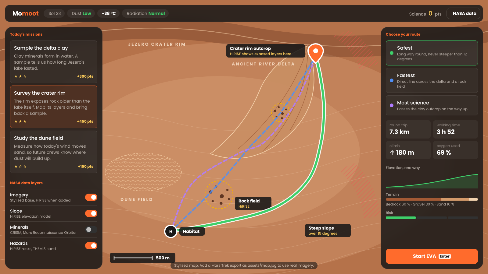
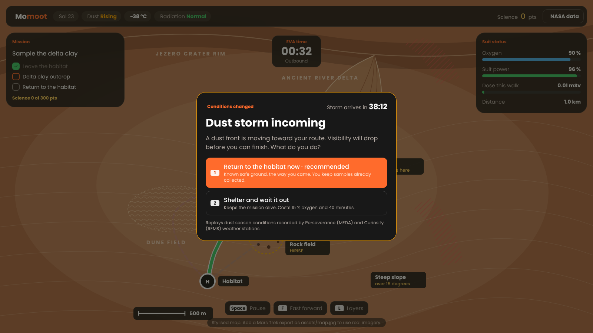

# Momoot · Komoot for Mars

A route planner game for astronauts on Mars, built by **Alice** for the
**2026 NASA Space Apps Challenge** · *Interplanetary Survival Guide: Martian Map*.

Pick today's science mission, compare three routes built from NASA orbiter data,
then walk it. Conditions on Mars change, so dust storms, solar particle events
and rough terrain force you to adapt on the way.



## Play it

No install and no build step. Either:

- **Open `index.html`** in Chrome, Edge, Firefox or Safari, or
- **Serve the folder** (needed for some browsers to load local photos):
  ```bash
  python3 -m http.server 8000
  # then open http://localhost:8000
  ```

To publish it, turn on **GitHub Pages** for this repo (Settings → Pages →
deploy from branch) and share the link.

### Controls

| Key | Action |
|---|---|
| `Enter` | Start planning / start the EVA |
| `1` `2` `3` | Pick a route (planning) or a choice (events) |
| `Space` | Pause the walk |
| `F` | Fast forward |
| `S` | Collect a sample at a stop |
| `+` `−` | Zoom the map |
| `D` | Draw mode: click the map to log `[lat, lon]` points |

## How it works

1. **Pick a mission**: delta clay sample, crater rim survey or dune field study.
2. **Choose a route**: *Safest*, *Fastest* or *Most science*. Each shows the round
   trip distance, walking time, climb, oxygen use, elevation profile, terrain mix
   and risk.
3. **Walk it**: the HUD tracks oxygen, suit power, radiation dose and distance.
   Science stops show what you would see on arrival.
4. **React**: events pause the walk and ask for a decision. Returning early,
   sheltering, or pushing on all have costs.
5. **Score**: science points, plus a safety bonus if you get home with more than
   30 % oxygen.



## NASA data

| Feature | Data | Type |
|---|---|---|
| Base map | HiRISE 25 cm and CTX 5 m imagery (Mars Reconnaissance Orbiter), Viking colour mosaic, live from [Mars Trek](https://trek.nasa.gov/mars/) | Optical |
| Elevation layer | MOLA colour shaded relief (Mars Global Surveyor) via Mars Trek | Topographic |
| Perseverance path | Mars 2020 traverse published by NASA JPL | Rover data |
| Science targets | CRISM mineral maps (MRO) | Spectral |
| Sand vs bedrock | THEMIS thermal data (Mars Odyssey) | Thermal |
| Stop photos | Perseverance raw images gallery | Ground imagery |
| Dust events | Perseverance MEDA and Curiosity REMS weather data | Atmospheric |
| Radiation events | Curiosity RAD measurements | Radiation |

## The map: real NASA imagery

The map loads live tiles from **NASA Mars Trek** in your browser, in Mars Trek's
equirectangular projection, so routes and pins sit on true Jezero coordinates.
Higher resolution layers fade in as you zoom:

| Zoom | Layer | Resolution |
|---|---|---|
| Wide | Viking MDIM 2.1 colour mosaic | 232 m per pixel |
| Regional | MRO CTX global mosaic (Caltech Murray Lab) | about 5 m per pixel |
| Close up | MRO HiRISE orthomosaic of the Mars 2020 landing site (USGS) | 25 cm per pixel |
| Optional | MGS MOLA colour shaded elevation | 463 m per pixel |

Drag to pan, scroll or use **+ / −** to zoom, and use the layers button to
switch base maps or show Perseverance's real path (loaded from NASA JPL if its
server allows it). An internet connection is needed for the tiles.

**Positions.** The habitat, mission targets and routes are placed approximately
for gameplay; the Octavia E. Butler Landing marker is Perseverance's real landing
site. To retrace a route precisely on the HiRISE imagery, press `D`, click along
your path, and copy the logged `[lat, lon]` points from the browser console into
`data/missions.js`. The cursor position is shown in the corner of the map.

**Photos.** Save Perseverance raw images as `assets/photos/delta.jpg`,
`assets/photos/dunes.jpg` and `assets/photos/rim.jpg`. Until then, stops show a
drawn illustration.

## Game rules

These are simple game rules, **not real spacesuit figures**:

- Walking speed 2 km/h on firm ground, up to 60 % slower on sand
- Oxygen: 7 % per km walked, plus 1 % per 10 m climbed
- Every walk is a round trip back to the habitat
- Radiation background uses roughly the surface average Curiosity's RAD measured
  (about 0.64 mSv per day); event doses are game values

## Project structure

```
index.html          layout: details column, map card, dialogs
style.css           design tokens and components (square corners throughout)
marsmap.js          small slippy map engine for NASA Mars Trek tiles
app.js              planning, route overlays, EVA loop, events, scoring
data/missions.js    missions, routes, stops, events, terrain
assets/fonts/       Poppins (SIL Open Font License)
assets/photos/      put Perseverance photos here
docs/               proposal, build plan, mockups, screenshots
```

## Design notes

The interface follows a strict design system: one typeface (Poppins), every
font size on the Tailwind type scale with named text styles, spacing from a
fixed token set, square corners everywhere, flat surfaces, Phosphor icons, one
easing curve (`cubic-bezier(0.22, 1, 0.36, 1)`), visible focus rings,
`prefers-reduced-motion` support, and a stacked layout below 900 px.

## Credits

- Built by Alice for NASA Space Apps 2026
- Mars data: NASA, JPL Caltech, University of Arizona (HiRISE), JHU APL (CRISM),
  ASU (THEMIS), MSSS (CTX)
- Font: Poppins by Indian Type Foundry, SIL Open Font License
- Icons: [Phosphor Icons](https://phosphoricons.com), MIT License
