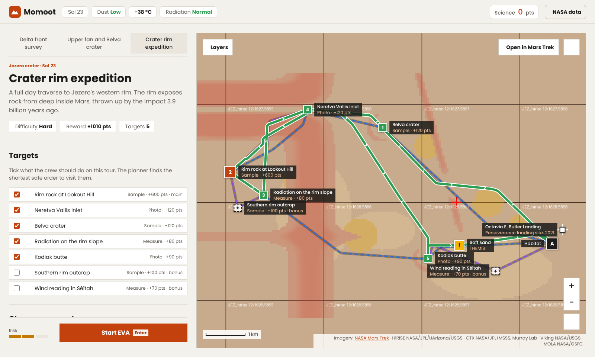

# Momoot · Komoot for Mars

A route planner game for astronauts on Mars, built by **Alice** for the
**2026 NASA Space Apps Challenge** · *Interplanetary Survival Guide: Martian Map*.

Pick today's science mission, compare three routes built from NASA orbiter data,
then walk it. Conditions on Mars change, so dust storms, solar particle events
and rough terrain force you to adapt on the way.

## ▶ Play now

**https://ruoyaoyan.github.io/nasa_hacka_alice/**

(Served by GitHub Pages. If the link shows a 404, turn Pages on once: Settings → Pages → Deploy from a branch → `main`, folder `/ (root)`.)



## Play it

No install and no build step. Either:

- **Open `index.html`** in Chrome, Edge, Firefox or Safari, or
- **Serve the folder** (needed for some browsers to load local photos):
  ```bash
  python3 -m http.server 8000
  # then open http://localhost:8000
  ```

To publish it, turn on **GitHub Pages** for this repo (Settings → Pages →
deploy from branch) and share the link.

### Controls

| Key | Action |
|---|---|
| `Enter` | Start planning / start the EVA |
| `1` `2` `3` | Pick a route (planning) or a choice (events) |
| `Space` | Pause the walk |
| `F` | Fast forward |
| `S` | Collect a sample at a stop |
| `P` | Log a photo point for the next crew |
| `+` `−` | Zoom the map |
| `D` | Draw mode: click the map to log `[lat, lon]` points |

## How it works

1. **Pick today's tasks**: a full page briefing shows five everyday tasks near the
   habitat, plus ten farther away. Each card has a real Perseverance photo of the
   place, points, time on site and distance. Tick up to seven and confirm.
2. **Choose a route**: *Safest*, *Fastest* or *Easiest*. Each visits the same
   targets you ticked and shows Komoot style route details (below).
3. **Walk it**: the HUD tracks oxygen, suit power, radiation dose and distance.
   Science stops show what you would see on arrival.
4. **Leave data for the next crew**: press `P` (or the button) to log a photo point
   tagged hazard, tip, science or view. It saves in your browser, appears on the
   map and in *Crew photo points*, and hazard reports make future routes keep clear.
5. **React**: events pause the walk and ask for a decision. Returning early,
   sheltering, or pushing on all have costs.
6. **Score**: science points, plus a safety bonus if you get home with more than
   30 % oxygen.

### Route details, as in Komoot

| Section | What it shows |
|---|---|
| Route details | Elevation profile on the Mars datum (Jezero floor about −2,560 m), steep stretches in orange, target markers. Click and drag to get uphill, downhill, highest and lowest point for that part; it is highlighted on the map |
| Climbs and descents | Each climb or descent with category, average grade, height gain and length. Click one to select it |
| Terrain types and surfaces | Kilometres of crater floor, delta deposits, rim slopes and sand fields, and of bedrock, gravel, loose sand, rough ground and boulders |
| Weather | Today plus the next sols: high and low temperature, dust opacity τ, wind, and tips. Illustrative values within the ranges Perseverance MEDA and Curiosity REMS recorded |
| Crew photo points | Notes and HiRISE snapshots left by earlier crews and by you |


## NASA data

| Feature | Data | Type |
|---|---|---|
| Base map | HiRISE 25 cm and CTX 5 m imagery (Mars Reconnaissance Orbiter), Viking colour mosaic, live from [Mars Trek](https://trek.nasa.gov/mars/) | Optical |
| Elevation layer | MOLA colour shaded relief (Mars Global Surveyor) via Mars Trek | Topographic |
| Perseverance path | Mars 2020 traverse published by NASA JPL | Rover data |
| Science targets | CRISM mineral maps (MRO) | Spectral |
| Sand vs bedrock | THEMIS thermal data (Mars Odyssey) | Thermal |
| Stop photos | Perseverance raw images gallery | Ground imagery |
| Dust events | Perseverance MEDA and Curiosity REMS weather data | Atmospheric |
| Radiation events | Curiosity RAD measurements | Radiation |

## The map: real NASA imagery

The map loads live tiles from **NASA Mars Trek** in your browser, in Mars Trek's
equirectangular projection, so routes and pins sit on true Jezero coordinates.
Higher resolution layers fade in as you zoom:

| Zoom | Layer | Resolution |
|---|---|---|
| Wide | Viking MDIM 2.1 colour mosaic | 232 m per pixel |
| Regional | MRO CTX global mosaic (Caltech Murray Lab) | about 5 m per pixel |
| Close up | MRO HiRISE orthomosaic of the Mars 2020 landing site (USGS) | 25 cm per pixel |
| Optional | MGS MOLA colour shaded elevation | 463 m per pixel |

Drag to pan, scroll or use **+ / −** to zoom, and use the layers button to
switch base maps or show Perseverance's real path (loaded from NASA JPL if its
server allows it). An internet connection is needed for the tiles. The **Open in Mars Trek** button opens the current view in NASA Mars Trek, where you can use its own distance, elevation profile and slope tools to check a route.

**Positions.** The habitat, mission targets and routes are placed approximately
for gameplay; the Octavia E. Butler Landing marker is Perseverance's real landing
site. To retrace a route precisely on the HiRISE imagery, press `D`, click along
your path, and copy the logged `[lat, lon]` points from the browser console into
`data/missions.js`. The cursor position is shown in the corner of the map.

**Photos.** Every task shows a real Perseverance image of that place (or the
closest one the rover imaged), loaded from NASA's servers when the game runs.
The list, with PIA numbers and credits, is `photos` in `data/missions.js`. If an
image cannot load, the card shows a HiRISE view of the exact spot instead.

## How routes are planned

Routes are not drawn by hand. Real traverses wind because the crew has several
things to do (collect samples, take photos, take measurements) and has to avoid
danger on the way. `planner.js` solves exactly that:

1. **Terrain cost map.** A grid of 50 m cells over the study area. Each cell has
   an elevation from a simplified terrain model of Jezero (delta front scarp
   with the Hawksbill Gap valley, upper fan, Kodiak butte, Belva crater, and the
   western rim notched by Neretva Vallis), a slope, and whether it lies in loose
   sand or a boulder field.
2. **Safest path between every pair of targets.** Dijkstra's algorithm runs from
   the habitat and from each target. A step costs distance times
   `1 + steep + sand + boulders`, weighted by the route profile.
3. **Best visiting order.** A depth first search with branch and bound tries
   every order of the targets (5 targets = 120 orders) and keeps the cheapest
   round trip from the habitat.
4. **Natural lines.** Grid zigzags are straightened where a straight line is just
   as safe (string pulling), then smoothed with Chaikin corner cutting.

The three options use different risk weights: **Safest** forbids slopes over 12°
and every boulder field, **Fastest** accepts sand, rocks and slopes up to 25°,
and **Easiest** keeps to gentle ground (slopes under 9°, long detours around sand)
so it is longer but has the least climbing. Press
**Change your mind?** on the route page to go back to the task page, add or drop
tasks, and confirm: all three routes are redesigned. Terrain events (boulders, sand) fire where the
chosen route actually enters those zones.

## Real hazard detection

Routes avoid dangers found in real NASA data, from two sources that feed the
same cost grid:

**1. Live scan of the HiRISE imagery (automatic).** `hazardscan.js` is a
JavaScript port of the image detector in `tools/terrain_hazard/hazards.py`.
When the game opens, it downloads the HiRISE tiles covering the planning area
(about 10 m per pixel), finds compact **shadows** (black top-hat) and
**sunlit faces** (white top-hat) as robust z-scores, and keeps only shadows
that have a sunlit partner next to them. That pairing is what relief looks
like from orbit, so it catches hills and buttes, crater walls, scarps and big
boulders, while broad dark sand or dust patches are ignored. It runs at two
scales (10 m and 30 m pixels) and also marks rough texture. Detected hazards
are blocked for the Safest and Easiest routes; Fastest may cross them
with a heavy penalty, which triggers a terrain event. The panel reports what
was found. If NASA's tile server does not allow the browser to read pixels,
the game says so and keeps using the terrain model.

**2. Elevation hazards from `tools/terrain_hazard` (optional, most accurate).**
Run the Python tool on the USGS 1 m HiRISE DTM and 25 cm orthomosaic of
Jezero for the Momoot planning area, then copy its `cost_matrix.json` into
`data/`:

```bash
pip install -r tools/terrain_hazard/requirements.txt
python3 tools/terrain_hazard/terrain_hazard.py \
  --dem   JEZ_hirise_soc_006_DTM_MOLAtopography_DeltaGeoid_1m_Eqc_latTs0_lon0_blend40.tif \
  --image JEZ_hirise_soc_006_orthoMosaic_25cm_Eqc_latTs0_lon0_first.tif \
  --center-latlon 18.46 77.3775 --size 10500 6600 --cell 10 \
  --origin-latlon 18.4385 77.4462 --out out/
cp out/cost_matrix.json data/cost_matrix.json
```

The game loads it on start and merges every blocked cell (steep slope,
crater, rock) into the route calculation, using the file's latitude and
longitude bounds. Download links for both USGS files are in
`tools/terrain_hazard/README.md`.

The habitat and every target are always kept reachable, so a detection on top
of a target never makes a mission impossible.

## Game rules

Tours are driven in a pressurised crew rover, with a walking EVA at every stop.
These are simple game rules, **not real mission figures**:

- Rover speed 6 km/h on firm ground, up to 50 % slower on sand
- Life support: 1.5 % per km, plus 0.5 % per 20 m climbed, plus 2 % per target
- 30 minutes per stop
- Radiation background uses roughly the surface average Curiosity's RAD measured
  (about 0.64 mSv per day); event doses are game values

## Tasks

| Today's five | Farther away |
|---|---|
| Clay sample at Hawksbill Gap, Three Forks sample depot, wind reading in Séítah, landing site survey, Enchanted Lake mudstone | Kodiak butte, Séítah sand, Belva crater wall, upper fan boulders, isolated hill, northern fan lobe, Neretva Vallis inlet, Lookout Hill rim rock, rim slope radiation, southern rim outcrop |

The task with the most points becomes the main task. A tour over 15 km adds a
radiation event on the open slopes.

Landmark positions and the terrain model are approximate, for gameplay.

## Project structure

```
index.html          layout: details column, map card, dialogs
style.css           design tokens and components (square corners throughout)
marsmap.js          small slippy map engine for NASA Mars Trek tiles
planner.js          terrain cost map, Dijkstra, DFS visiting order, smoothing
hazardscan.js       live hazard detection on HiRISE tiles (port of hazards.py)
tools/terrain_hazard/  Python hazard grid from the HiRISE DTM and orthoimage
app.js              planning, route overlays, EVA loop, events, scoring
data/missions.js    missions, routes, stops, events, terrain
assets/fonts/       Poppins (SIL Open Font License)
docs/               proposal, build plan, mockups, screenshots
```

## Design notes

The interface follows a strict design system: one typeface (Poppins), every
font size on the Tailwind type scale with named text styles, spacing from a
fixed token set, square corners everywhere, flat surfaces, Phosphor icons, one
easing curve (`cubic-bezier(0.22, 1, 0.36, 1)`), visible focus rings,
`prefers-reduced-motion` support, and a stacked layout below 900 px.

## Credits

- Built by Alice for NASA Space Apps 2026
- Mars data: NASA, JPL Caltech, University of Arizona (HiRISE), JHU APL (CRISM),
  ASU (THEMIS), MSSS (CTX)
- Font: Poppins by Indian Type Foundry, SIL Open Font License
- Icons: [Phosphor Icons](https://phosphoricons.com), MIT License
