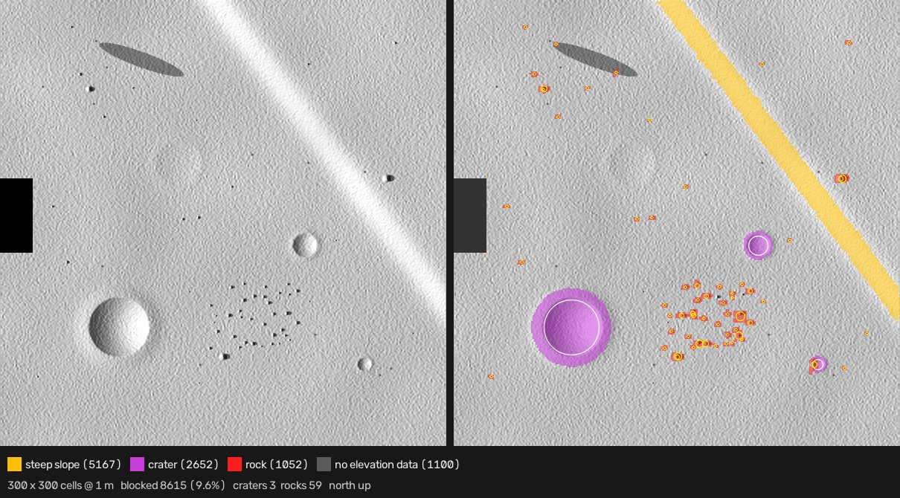

# Terrain hazard grid

Turns NASA terrain data into a **cost matrix**: a 2D grid of `0` (walkable) and `1` (blocked).
This is an offline Python tool. It is not part of the Vite build.



| Input | What it's used for |
|---|---|
| DEM (elevation, GeoTIFF in meters) | steep slopes, craters (closed depressions), large boulders, missing data |
| Orthoimage (overhead image, same projection as the DEM) | rocks (sunlit side + shadow), crater circles confirmed against the DEM |
| Rover photo (Perseverance Navcam / Hazcam / Mastcam-Z) | rock detection **in the photo itself** (`rover_rocks.py`), see limits below |

## Install

```bash
pip install numpy opencv-python scikit-image tifffile imagecodecs
```

`imagecodecs` is needed for LZW-compressed GeoTIFFs, which is how USGS publishes the Jezero mosaics. GDAL is not needed.

## Run on real Perseverance-site data (Jezero crater)

USGS publishes the Mars 2020 Terrain Relative Navigation mosaics, made from MRO HiRISE stereo:

- DTM mosaic, 1 m/pixel (1.8 GB): https://planetarymaps.usgs.gov/mosaic/mars2020_trn/HiRISE/JEZ_hirise_soc_006_DTM_MOLAtopography_DeltaGeoid_1m_Eqc_latTs0_lon0_blend40.tif
- Orthoimage mosaic, 25 cm/pixel (3.2 GB): download link on https://astrogeology.usgs.gov/search/map/Mars/Mars2020/JEZ_hirise_soc_006_orthoMosaic_25cm_Eqc_latTs0_lon0_first

Both use an equirectangular projection with `lat_ts = 0, lon0 = 0` (it's in the file names), which matches the script's `--eqc-*` defaults. Only the requested window is read, so you don't need to crop first.

```bash
python3 tools/terrain_hazard/terrain_hazard.py \
  --dem   JEZ_hirise_soc_006_DTM_MOLAtopography_DeltaGeoid_1m_Eqc_latTs0_lon0_blend40.tif \
  --image JEZ_hirise_soc_006_orthoMosaic_25cm_Eqc_latTs0_lon0_first.tif \
  --center-latlon 18.4447 77.4508 --size 300 300 --cell 1 --out out/
```

(18.4447 N, 77.4508 E is approximately Perseverance's landing site. Use any point inside the mosaic.)

Add `--origin-latlon LAT LON` (the habitat) to get a `localFrame` block in the game's coordinates. See "Using it in the app" below.

Other inputs:

```bash
python3 tools/terrain_hazard/terrain_hazard.py --dem any_dem.tif --cell 2 --max-slope 15 --out out/   # DEM only
python3 tools/terrain_hazard/terrain_hazard.py --dem heightmap.npy --pixel-size 1.0 --out out/       # plain array/PNG
python3 tools/terrain_hazard/terrain_hazard.py --dem d.tif --bbox WEST SOUTH EAST NORTH --out out/   # map coordinates
python3 tools/terrain_hazard/rover_rocks.py rover_photo.png --out out_rover/                         # rover photo
```

A single HiRISE PDS DTM (`.IMG`) can be converted first with `gdal_translate in.IMG out.tif`.

## Outputs (`--out`)

| File | Content |
|---|---|
| `cost_matrix.json` | `grid[row][col]` of 0/1, plus `reasons`, size, cell size, map bounds, approximate lat/lon bounds, stats, parameters used |
| `cost_matrix.csv` / `.npy` / `.tif` | the same 0/1 grid (the `.tif` is georeferenced) |
| `reasons.npy` | why a cell is blocked, as bits: 1 = steep slope, 2 = crater, 4 = rock, 8 = no elevation data |
| `detections.json` | each crater and rock: map x/y, diameter, depth or height, source (`dem`, `image`, `image+dem`) |
| `hazard_overlay.png` | input image beside the hazard layers, for checking by eye |

Row 0 is the **north** edge and column 0 the **west** edge.

## Using it in the app

`src/config/mission.js` uses metres from the habitat, +X east and −Z north. Run with `--origin-latlon` (or `--origin X Y` in map coordinates) set to the habitat, and `cost_matrix.json` gets a `localFrame` block. Then:

```js
const hz = await (await fetch('cost_matrix.json')).json();
const { westX, northZ, cellSizeM } = hz.localFrame;
function isBlocked(x, z) {
  const col = Math.floor((x - westX) / cellSizeM);
  const row = Math.floor((z - northZ) / cellSizeM);
  if (row < 0 || col < 0 || row >= hz.height || col >= hz.width) return true; // outside = unknown
  return hz.grid[row][col] === 1;
}
// why a cell is blocked: hz.reasons[row][col] & 1 slope, & 2 crater, & 4 rock, & 8 no data
```

The default `--max-slope 20` matches the "no-go > 20°" class in the app's slope legend (`src/data/layers.js`).

## How each hazard is found

- **Steep slope**: Horn's 3×3 gradient on the DEM. Blocked above `--max-slope` (default 20°, an assumption for a walking crew).
- **Craters**: fill-sinks (morphological reconstruction) gives the depth of every closed depression. A crater is kept when it is round enough, 4–150 m across and at least 1 m deep. The bowl plus a rim band of 0.2 × diameter is blocked. Shallow, eroded bowls stay walkable. Hough circles in the image add craters the DEM missed, but only when the DEM shows the floor at least 1 m below the rim.
- **Rocks (image)**: black and white top-hats pick out small dark (shadow) and bright (sunlit) blobs. Broad dark sand patches don't respond because they're wider than the filter. A rock is a compact shadow next to a sunlit blob, on the sun side if `--sun-azimuth` is given. With `--sun-elevation` the height comes from shadow length, and rocks shorter than 0.3 m are dropped. Each rock plus a 0.5 m clearance is blocked.
- **Rocks (DEM)**: isolated bumps at least 1 m tall where the ground falls away on all sides. Ridge and rim fragments are rejected.
- **No elevation data** is blocked. Unknown ground is never treated as flat.

A cell is blocked if any part of it is hazardous (`--block-fraction 0`). Raise that value for a less conservative grid.

## Tuning

Common settings are flags (`--max-slope`, `--crater-min-depth`, `--rock-min-diameter`, `--rock-clearance`, `--sun-azimuth`, `--sun-elevation`, `--block-fraction`, `--no-hough`). Everything else is in `hazards.Params` and can be set from a JSON file with `--params params.json`, e.g. `{"rock_shadow_z": 6, "crater_max_diameter_m": 300}`.

## Tests and results

```bash
python3 tools/terrain_hazard/make_synthetic.py synthetic/     # synthetic DEM + ortho + truth.json
python3 -m pytest tools/terrain_hazard/tests -q                # 18 tests
```

The synthetic scene (300 × 300 m, 1 m DEM, 25 cm image) has 3 hazardous craters, 1 shallow walkable bowl, a ~40° scarp, 56 rocks, a no-data strip and decoys. These are a dark sand streak and dark spots with no sunlit side. Current results:

- **Slopes:** IoU with the true >20° area is 0.94.
- **Craters:** all 3 hazardous craters found, diameters within 15%. The shallow bowl is left walkable.
- **Rocks:** 51 of 56 rock cells blocked. 6 of 59 rock detections are false. 1 of 12 decoys is hit.
- **Rover photos (synthetic):** about 96% of rocks found, no false detections across 5 scenes.
- **Speed:** a 900 × 900 m area (3,600² px image) runs in about 8 s.

## Limits

- Thresholds are tuned on the synthetic scene. Check `hazard_overlay.png` on real HiRISE data and adjust `rock_shadow_z` / `rock_bright_z` before trusting the rock layer.
- HiRISE (25 cm/px) only resolves rocks about 1 m and larger. Smaller rocks are not in the grid.
- The 1 m DEM smooths away sub-meter steps. The slope limit is an assumption, not an EVA requirement.
- **Rover photos are perspective views**, so `rover_rocks.py` reports rocks in image pixels. Putting them on the map grid needs the camera pose and model (CAHVOR, in the image's PDS label), which isn't implemented.
- The orthomosaic is stitched from several HiRISE images with different sun directions. On the mosaic, leave `--sun-azimuth` unset unless the area comes from one image.
